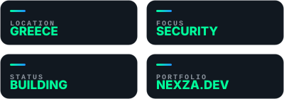
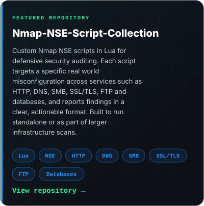
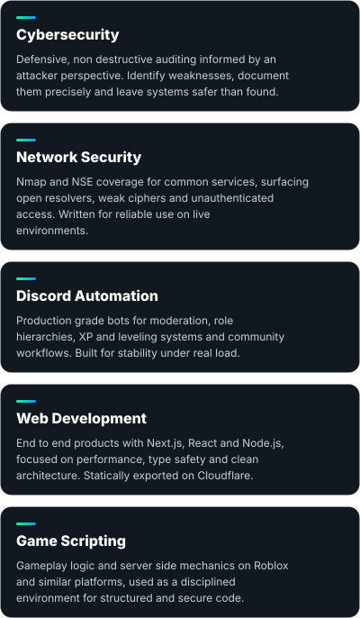

<a href="https://nexza.dev"><picture><source media="(min-width: 1012px)" srcset="assets/svg/hero.svg" /></picture></a>

<a href="https://nexza.dev"><picture><source media="(min-width: 1012px)" srcset="assets/svg/badges.svg" /></picture></a>

<picture></picture>

<picture><source media="(prefers-color-scheme: light) and (min-width: 1012px)" srcset="assets/svg/header-about-light.svg" /><source media="(prefers-color-scheme: dark) and (min-width: 1012px)" srcset="assets/svg/header-about-dark.svg" /><source media="(prefers-color-scheme: light)" srcset="assets/svg/header-about-light-mobile.svg" /><source media="(prefers-color-scheme: dark)" srcset="assets/svg/header-about-dark-mobile.svg" /></picture>

<picture><source media="(min-width: 1012px)" srcset="assets/svg/intro.svg" /></picture>

<picture></picture>

<picture><source media="(prefers-color-scheme: light) and (min-width: 1012px)" srcset="assets/svg/header-experience-light.svg" /><source media="(prefers-color-scheme: dark) and (min-width: 1012px)" srcset="assets/svg/header-experience-dark.svg" /><source media="(prefers-color-scheme: light)" srcset="assets/svg/header-experience-light-mobile.svg" /><source media="(prefers-color-scheme: dark)" srcset="assets/svg/header-experience-dark-mobile.svg" /></picture>

<a href="https://github.com/Sonix-Devs"><picture><source media="(min-width: 1012px)" srcset="assets/svg/experience.svg" /></picture></a>

<picture></picture>

<picture><source media="(prefers-color-scheme: light) and (min-width: 1012px)" srcset="assets/svg/header-projects-light.svg" /><source media="(prefers-color-scheme: dark) and (min-width: 1012px)" srcset="assets/svg/header-projects-dark.svg" /><source media="(prefers-color-scheme: light)" srcset="assets/svg/header-projects-light-mobile.svg" /><source media="(prefers-color-scheme: dark)" srcset="assets/svg/header-projects-dark-mobile.svg" /></picture>

<a href="https://github.com/NexzaDev/Nmap-NSE-Script-Collection"><picture><source media="(min-width: 1012px)" srcset="assets/svg/project-nmap.svg" /></picture></a>

<picture></picture>

<picture><source media="(prefers-color-scheme: light) and (min-width: 1012px)" srcset="assets/svg/header-focus-areas-light.svg" /><source media="(prefers-color-scheme: dark) and (min-width: 1012px)" srcset="assets/svg/header-focus-areas-dark.svg" /><source media="(prefers-color-scheme: light)" srcset="assets/svg/header-focus-areas-light-mobile.svg" /><source media="(prefers-color-scheme: dark)" srcset="assets/svg/header-focus-areas-dark-mobile.svg" /></picture>

<picture><source media="(min-width: 1012px)" srcset="assets/svg/focus.svg" /></picture>

<picture></picture>

<picture><source media="(prefers-color-scheme: light) and (min-width: 1012px)" srcset="assets/svg/header-technologies-light.svg" /><source media="(prefers-color-scheme: dark) and (min-width: 1012px)" srcset="assets/svg/header-technologies-dark.svg" /><source media="(prefers-color-scheme: light)" srcset="assets/svg/header-technologies-light-mobile.svg" /><source media="(prefers-color-scheme: dark)" srcset="assets/svg/header-technologies-dark-mobile.svg" /></picture>

<picture><source media="(min-width: 1012px)" srcset="assets/svg/stack.svg" /></picture>

<picture></picture>

<picture><source media="(prefers-color-scheme: light) and (min-width: 1012px)" srcset="assets/svg/header-background-light.svg" /><source media="(prefers-color-scheme: dark) and (min-width: 1012px)" srcset="assets/svg/header-background-dark.svg" /><source media="(prefers-color-scheme: light)" srcset="assets/svg/header-background-light-mobile.svg" /><source media="(prefers-color-scheme: dark)" srcset="assets/svg/header-background-dark-mobile.svg" /></picture>

<picture><source media="(min-width: 1012px)" srcset="assets/svg/background.svg" /></picture>

<picture></picture>

<picture><source media="(prefers-color-scheme: light) and (min-width: 1012px)" srcset="assets/svg/header-coding-stats-light.svg" /><source media="(prefers-color-scheme: dark) and (min-width: 1012px)" srcset="assets/svg/header-coding-stats-dark.svg" /><source media="(prefers-color-scheme: light)" srcset="assets/svg/header-coding-stats-light-mobile.svg" /><source media="(prefers-color-scheme: dark)" srcset="assets/svg/header-coding-stats-dark-mobile.svg" /></picture>

<picture>
  <source media="(prefers-color-scheme: dark)" srcset="https://raw.githubusercontent.com/NexzaDev/NexzaDev/output/github-snake-dark.svg" />
  <source media="(prefers-color-scheme: light)" srcset="https://raw.githubusercontent.com/NexzaDev/NexzaDev/output/github-snake.svg" />
  
</picture>

<picture></picture>

<picture><source media="(prefers-color-scheme: light) and (min-width: 1012px)" srcset="assets/svg/header-connect-light.svg" /><source media="(prefers-color-scheme: dark) and (min-width: 1012px)" srcset="assets/svg/header-connect-dark.svg" /><source media="(prefers-color-scheme: light)" srcset="assets/svg/header-connect-light-mobile.svg" /><source media="(prefers-color-scheme: dark)" srcset="assets/svg/header-connect-dark-mobile.svg" /></picture>

<picture><source media="(min-width: 1012px)" srcset="assets/svg/footer.svg" /></picture>
